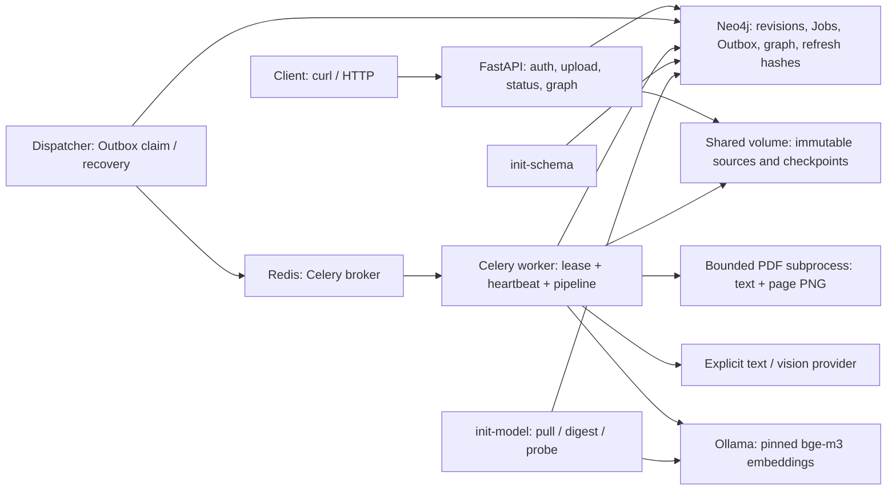
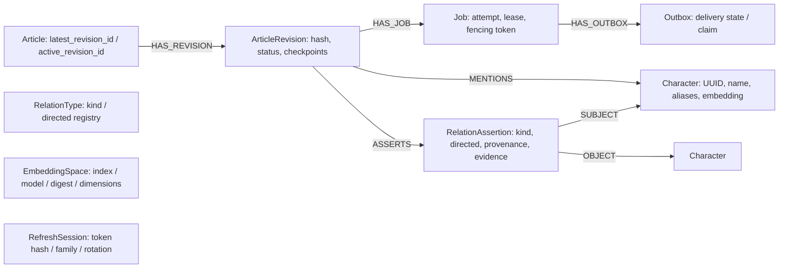

# Article Graph

API для превращения Markdown и PDF в граф персонажей и подтверждённых связей.
Загрузка сохраняет исходник и задачу; фоновые процессы извлекают сведения,
сопоставляют персонажей и атомарно публикуют новую версию графа с evidence.
Чтение доступно только по Access JWT и только из опубликованных версий.

## Быстрый запуск

Нужны Docker с Linux containers и Compose v2, свободный `127.0.0.1:8000`,
интернет для первого скачивания образов/модели и несколько GB свободной RAM.
Для Python-команд нужны обычный **CPython 3.15.2** и **uv 0.13.6**:
без free-threaded, JIT и глобального lazy-import mode. API работает в Linux
контейнере и при Windows-хосте; prefork worker запускается в контейнере.

Из корня проекта создайте `.env`, если его ещё нет (PowerShell):

```powershell
if (-not (Test-Path .env)) { Copy-Item .env.example .env }
```

Заполните первые строки файла. Например, для DeepSeek:

```dotenv
ARTICLE_GRAPH_LLM__BASE_URL=https://api.deepseek.com
ARTICLE_GRAPH_LLM__API_KEY=<provider-api-key>
ARTICLE_GRAPH_LLM__TEXT_MODEL=deepseek-flash
ARTICLE_GRAPH_LLM__OUTPUT_MODE=json_object
# Для PDF явно задайте поддерживающую изображения модель этого же API:
# ARTICLE_GRAPH_LLM__VISION_MODEL=deepseek-flash
```

`TEXT_MODEL` — точный идентификатор модели в API провайдера, а не URL или API key.
Для другого провайдера замените URL/model и укажите его JSON mode. Пример сверяется
с [API DeepSeek](https://api-docs.deepseek.com/) и [JSON Output](https://api-docs.deepseek.com/guides/json_mode/);
это пример настройки, а не успешный live-прогон проекта. Провайдер автоматически
не выбирается; URL, API key, text model и output mode обязательны. Не оставляйте
placeholder ключа: непустой placeholder не может быть распознан как настоящий ключ
при локальной валидации и даст ошибку только при запросе к провайдеру.

В [.env.example](.env.example) уже заданы публичные демонстрационные реквизиты
приложения и Neo4j для одноразовой локальной проверки. Для других развёртываний
замените их независимыми случайными значениями: App Token, Access signing key и
Refresh signing key — разные строки по 32+ символа; отдельно пароль Neo4j.
Это не ключи LLM-провайдера. Локальный `.env` исключён из Git и Docker build context;
его значения не выводите через `docker compose config` без `--quiet`.

Одна команда запускает все компоненты, схему и загрузку embedding-модели:

```powershell
docker compose up -d --build --wait --wait-timeout 1800
```

`init-schema` создаёт constraints/indexes в Neo4j; `init-model` скачивает
**bge-m3:567m**, сверяет закреплённый в `.env.example` SHA-256 manifest и проверяет
реальный 1024-мерный embedding. Объём модели — примерно 1.2 GB; время зависит от
сети/CPU. Модель хранится в named volume и повторно используется. Это embedding
модель; удалённые text/vision модели не скачиваются в Ollama. При неверном digest,
размерности или недоступной модели init завершается ошибкой и блокирует зависимые
сервисы. Не меняйте модель/digest/размерность существующего индекса без миграции.

```powershell
docker compose ps -a
docker compose config --quiet
```

Оба init должны завершиться с exit 0; API/worker/dispatcher и инфраструктура —
healthy. API: [Swagger](http://127.0.0.1:8000/docs),
[OpenAPI](http://127.0.0.1:8000/openapi.json),
[ReDoc](http://127.0.0.1:8000/redoc). Redis, Neo4j и Ollama не публикуют порты
рабочего Compose; внутренние URL и общий `/data/blobs` Compose задаёт сам.
`docker compose stop` и последующий `docker compose up -d --wait --wait-timeout 1800`
сохраняют named volumes. `down --volumes` для рабочих данных не используйте.
Подробности и изолированная приёмка: [Docker](docs/docker.md).

## HTTP: полный сценарий с curl

Примеры для PowerShell и `curl.exe`; на Linux с PowerShell 7 замените имя команды
на `curl`. Выполняйте из корня проекта. Нужен запущенный стек, файл `article.pdf`
для PDF-примера и ваш App Token. JWT ниже остаются в переменных процесса;
не используйте `-v`, не сохраняйте auth responses в отчёты. Все ключи в примерах —
placeholders. В переменной `$Base` можно указать адрес тестового API.

<!-- p23:session -->
```powershell
$Base = 'http://127.0.0.1:8000'
$AppToken = '<app-token-from-local-env>'
$Live = curl.exe --silent --show-error --fail-with-body "$Base/health/live" | ConvertFrom-Json
$Ready = curl.exe --silent --show-error --fail-with-body "$Base/health/ready" | ConvertFrom-Json
$OpenApi = curl.exe --silent --show-error --fail-with-body "$Base/openapi.json" | ConvertFrom-Json
$Swagger = curl.exe --silent --show-error --fail-with-body "$Base/docs"
$Redoc = curl.exe --silent --show-error --fail-with-body "$Base/redoc"
$Tokens = @{ app_token = $AppToken } | ConvertTo-Json -Compress |
    curl.exe --silent --show-error --fail-with-body -X POST "$Base/auth/token" -H 'Content-Type: application/json' --data-binary '@-' |
    ConvertFrom-Json
$Access = $Tokens.access_token
$Refresh = $Tokens.refresh_token
```

`/health/live` проверяет только процесс. `/health/ready` проверяет схему Neo4j
и настоящий embedding/digest Ollama; не выполняет LLM smoke и не проверяет брокер
или доступность worker. При неготовности возвращает 503. Swagger/OpenAPI публичны.
Access TTL по умолчанию 900 с, Refresh TTL — 86400 с. App Token даёт право получить
JWT; бизнес-маршруты принимают только Access, Refresh вместо него даёт 401.

### Загрузка, poll, no-op и update

Ровно одно из полей `text` или `file`. `text` — UTF-8 Markdown; `file` — PDF либо
UTF-8 Markdown (`application/pdf`, `text/markdown` или `text/plain`). Имена файлов
не определяют путь хранения. Для нового исходника ответ 202: `article_id`,
`revision_id`, `job_id`, `status_url`, `status`, `unchanged=false`.

<!-- p23:upload -->
```powershell
$Markdown = "# Synthetic example`nAlice and Bob are friends. Alice met Bob."
$Upload = curl.exe --silent --show-error --fail-with-body -X POST "$Base/articles/upload" -H "Authorization: Bearer $Access" --form-string "text=$Markdown" | ConvertFrom-Json
$ArticleId = $Upload.article_id
$RevisionId = $Upload.revision_id
$JobId = $Upload.job_id
$Deadline = [DateTime]::UtcNow.AddSeconds(180)
do {
    $State = curl.exe --silent --show-error --fail-with-body "$Base$($Upload.status_url)" -H "Authorization: Bearer $Access" | ConvertFrom-Json
    if ($State.status -in @('completed', 'failed')) { break }
    Start-Sleep -Seconds 1
} while ([DateTime]::UtcNow -lt $Deadline)
if ($State.status -notin @('completed', 'failed')) { throw 'Polling deadline exceeded' }
if ($State.status -eq 'failed') { throw "Processing failed: $($State.error.code)" }
$Noop = curl.exe --silent --show-error --fail-with-body -X POST "$Base/articles/upload" -H "Authorization: Bearer $Access" --form-string "text=$Markdown" | ConvertFrom-Json
```

`GET /articles/{article_id}` возвращает HTTP 200 и текущий `status`, даже если
обработка failed; смотрите `error.code`. Poll deadline клиента не отменяет Job.
No-op — HTTP 200, `unchanged=true`, прежние article/revision/job ID, без нового AI
вызова. Сравниваются SHA-256 исходных байтов, а не смысл текста. Для failed исходника
повторная загрузка тоже no-op — для новой попытки используйте retry.

Чтобы загрузить Markdown-файл, сохраните те же байты, затем выполните:

<!-- p23:markdown-file -->
```powershell
[IO.File]::WriteAllText((Join-Path $PWD 'article.md'), $Markdown, [Text.UTF8Encoding]::new($false))
$FileUpload = curl.exe --silent --show-error --fail-with-body -X POST "$Base/articles/upload" -H "Authorization: Bearer $Access" -F 'file=@article.md;type=text/markdown' | ConvertFrom-Json
```

Это no-op для тех же байтов. PDF проходит тот же путь, с обязательной vision model;
статус PDF также нужно poll-ить через возвращённый `status_url`:

<!-- p23:pdf -->
```powershell
$PdfUpload = curl.exe --silent --show-error --fail-with-body -X POST "$Base/articles/upload" -H "Authorization: Bearer $Access" -F 'file=@article.pdf;type=application/pdf' | ConvertFrom-Json
```

Изменение статьи с явным `article_id` создаёт revision № N+1:

<!-- p23:update -->
```powershell
$Changed = "# Synthetic example P21_CHANGED`nAlice and Carol are friends. Alice met Carol."
$Update = curl.exe --silent --show-error --fail-with-body -X POST "$Base/articles/upload" -H "Authorization: Bearer $Access" --form-string "article_id=$ArticleId" --form-string "text=$Changed" | ConvertFrom-Json
$Upload = $Update
# Повторите do/while polling выше для $Upload.status_url перед чтением нового графа.
```

С явным ID hash сравнивается с последней входной revision этой статьи. Без ID —
с последними исходниками всех статей; при нескольких совпадениях выбирается
минимальный article UUID. Pending/failed update не скрывает предыдущую active
revision. Публикация новой revision атомарно заменяет active pointer; исторические
утверждения сохраняются, но больше не выдаются как активные.

Необязательный `Idempotency-Key` позволяет воспроизвести первоначальные HTTP-код
и body регистрации, даже после завершения/обновления статьи. Повтор ключа с другим
запросом — 409 `idempotency_conflict`; это отдельный механизм от hash no-op.

<!-- p23:idempotency -->
```powershell
$ReplayKey = '<unique-idempotency-key>'
$First = curl.exe --silent --show-error --fail-with-body -X POST "$Base/articles/upload" -H "Authorization: Bearer $Access" -H "Idempotency-Key: $ReplayKey" --form-string "text=$Markdown" | ConvertFrom-Json
$Replay = curl.exe --silent --show-error --fail-with-body -X POST "$Base/articles/upload" -H "Authorization: Bearer $Access" -H "Idempotency-Key: $ReplayKey" --form-string "text=$Markdown" | ConvertFrom-Json
```

### Чтение графа, refresh и retry

После completed ответ GET — `Page<T>`: `items`, `limit`, `offset`, `next_offset`.
Если `next_offset` не null, подставьте его в следующий запрос. По умолчанию limit=20,
максимум 100; offset до `2**63 - 1`. Пагинация не даёт snapshot между запросами.

<!-- p23:graph -->
```powershell
$Characters = curl.exe --silent --show-error --fail-with-body "$Base/characters?limit=20&offset=0" -H "Authorization: Bearer $Access" | ConvertFrom-Json
$ArticleCharacters = curl.exe --silent --show-error --fail-with-body "$Base/characters/by_article/$($ArticleId)?limit=20&offset=0" -H "Authorization: Bearer $Access" | ConvertFrom-Json
$Types = curl.exe --silent --show-error --fail-with-body "$Base/relations/types?limit=20&offset=0" -H "Authorization: Bearer $Access" | ConvertFrom-Json
$CharacterId = $ArticleCharacters.items[0].character_id
$Connected = curl.exe --silent --show-error --fail-with-body "$Base/relations/connected/$($CharacterId)?limit=20&offset=0" -H "Authorization: Bearer $Access" | ConvertFrom-Json
$Friends = curl.exe --silent --show-error --fail-with-body "$Base/relations/connected/$($CharacterId)?type=FRIEND_OF&limit=20&offset=0" -H "Authorization: Bearer $Access" | ConvertFrom-Json
```

Если извлечение не дало персонажей, список пуст: не обращайтесь к `items[0]`.
`type` — точное каноническое имя типа. Directed связи выдаются только от subject,
симметричные — с любого конца. `FRIEND_OF` симметричен, `PARENT_OF` направлен
от родителя к ребёнку. Утверждения разных статей имеют отдельные relation IDs
и сохраняют `article_id`, `revision_id`, text/visual evidence, fragment/page.
Неизвестные UUID — 404; неверные UUID/query/body — 422; без Access — 401.

Refresh ротируется при каждом использовании; замените сразу оба токена:

<!-- p23:refresh -->
```powershell
$Tokens = @{ refresh_token = $Refresh } | ConvertTo-Json -Compress |
    curl.exe --silent --show-error --fail-with-body -X POST "$Base/auth/refresh" -H 'Content-Type: application/json' --data-binary '@-' |
    ConvertFrom-Json
$Access = $Tokens.access_token
$Refresh = $Tokens.refresh_token
$StateAfterRefresh = curl.exe --silent --show-error --fail-with-body "$Base/articles/$ArticleId" -H "Authorization: Bearer $Access" | ConvertFrom-Json
```

Повтор старого Refresh даёт 401 `refresh_reused` и отзывает семейство Refresh.
Уже выданный Access stateless и действует до exp; мгновенного отзыва Access нет.

Ручной retry применим только к latest failed revision. Подставьте её article UUID:

<!-- p23:retry -->
```powershell
$FailedArticleId = '<failed-article-uuid>'
$Retry = curl.exe --silent --show-error --fail-with-body -X POST "$Base/articles/$FailedArticleId/retry" -H "Authorization: Bearer $Access" | ConvertFrom-Json
# Poll $Retry.status_url тем же циклом. Тот же revision_id, новый job_id.
```

Ответ 202; completed/queued/processing или уже принятый retry — 409 `retry_conflict`.
Retry не исправляет неподдерживаемый документ или неверные настройки провайдера.
Преходящие ошибки worker повторяет сам, максимум 3 processing attempts на Job
по умолчанию. Коды ошибок безопасны: документы/ответы провайдера не включаются.
Подробные контракты: [auth](docs/auth.md), [upload/status/retry](docs/article-http.md),
[чтение графа](docs/graph-http.md), [DTO](src/article_graph/domain.py).

| Метод | Путь | Доступ | Основной успешный ответ |
| --- | --- | --- | --- |
| GET | `/health/live` | public | 200 |
| GET | `/health/ready` | public | 200 либо 503 |
| POST | `/auth/token` | App Token в JSON | 200 |
| POST | `/auth/refresh` | Refresh в JSON | 200 |
| POST | `/articles/upload` | Access | 202, no-op 200 |
| GET | `/articles/{article_id}` | Access | 200 |
| POST | `/articles/{article_id}/retry` | Access | 202 |
| GET | `/characters` | Access | 200 |
| GET | `/characters/by_article/{article_id}` | Access | 200 |
| GET | `/relations/types` | Access | 200 |
| GET | `/relations/connected/{character_id}` | Access | 200 |

## Компоненты и модель графа



Ниже реальные типы узлов/рёбер основной схемы. `active_revision_id` — свойство
Article, evidence — JSON-свойство RelationAssertion, embedding — свойство Character.
Произвольный тип связи хранится в `kind`, а не интерполируется в имя ребра Cypher.



[Схема и индексы](src/article_graph/db/schema.py), [публикация](docs/publication.md),
[pipeline/checkpoints](docs/pipeline.md), [обоснования и масштабирование](docs/decisions.md).

## Промпты, провайдер и лимиты

Полные versioned тексты, без сокращённых пересказов:

- [Document system](src/article_graph/prompts/document-system.v1.txt) и
  [Document user template](src/article_graph/prompts/document-user.v1.txt) — extraction pipeline.
- [JSON instruction](src/article_graph/prompts/json.v1.txt) — формат и output schema.
- [Identity](src/article_graph/prompts/identity.v1.txt) — решение по кандидатам.
- [Extraction](src/article_graph/prompts/extraction.v1.txt) — отдельный adapter extract path.

Нужен OpenAI-compatible `POST /chat/completions`, Bearer API key, non-streaming
ответ `choices[].message.content` с JSON, режим `json_object` либо `json_schema`.
Для vision — `image_url` с base64 PNG data URL на том же endpoint/key. Значения
моделей задаются явно; автоматического fallback на другую модель/провайдера нет.
Prompt/schema добавляются к запросу; Pydantic и evidence validation проверяют ответ.
Совместимость конкретной text/vision пары подтверждает только отдельный live smoke.
PDF отправляется постранично как текст и PNG, поэтому даже текстовый PDF требует
vision model. Документы передаются выбранному провайдеру — используйте разрешённые
для этого данные. Retrieval score не доказывает тождество персонажей.

| Бюджет по умолчанию | Значение |
| --- | --- |
| Upload / PDF pages | 2 MiB / 20 |
| PDF render | 144 dpi; 4 млн pixels/page; 40 млн pixels/document |
| PDF subprocess | 30 с; 512 MiB memory limit в Linux |
| Chunk / overlap / total prepared chars | 8000 / 800 / 160000 |
| Chunks / provider calls per attempt | 20 / 20 |
| Extraction concurrency / provider request deadline | 2 / 30 с |
| Provider input/request / total input | 16 млн / 64 млн bytes (с base64 и schema) |
| LLM max_tokens / maximum response bytes | 4096 / 2 млн |
| Processing / attempts per Job | 300 с / 3 |
| Characters / relations / evidence per relation | 100 / 200 / 5 |
| Pagination default / maximum | 20 / 100 |

При превышении — явная ошибка, не молчаливое обрезание документа. Windows не даёт
Linux RLIMIT_AS; это ограничение проверяется в Linux контейнере. Lease по умолчанию
120 с, heartbeat 15 с. Верхняя граница timeout не является SLA времени завершения:
очередь и недоступность инфраструктуры могут увеличить ожидание. Env overrides:
`ARTICLE_GRAPH_LIMITS__PDF_PAGES=10` и аналогично другим полям. Полный источник
значений — [Settings/Limits](src/article_graph/settings.py); детали —
[PDF](docs/pdf.md), [LLM adapter](docs/llm.md), [embeddings](docs/embeddings.md).

## Структура проекта

В `src/article_graph` модули сгруппированы в `api`, `security`, `documents`,
`ai`, `db` и `processing`; приложение, настройки и общие DTO остались в корне.
Тесты сгруппированы по соответствующим областям и отдельным процессным наборам.
Назначение пакетов, точки входа и результаты проверки переноса:
[структура проекта](docs/structure.md).

## Проверки без платных API

Все Python-команды ниже используют uv 0.13.6 и frozen lock. Если системный uv
другой версии, замените `uv` на `.venv/Scripts/uv.exe` в Windows либо установите
закреплённый uv. Для unit/mock/runtime проверок инфраструктура не нужна:

```powershell
uv sync --frozen
uv run --frozen ruff check .
uv run --frozen ruff format --check .
uv run --frozen pyrefly check
uv run --frozen pytest
```

Обычный pytest пропускает opt-in наборы; это не доказательство их прохождения.
Для repository/API/pipeline интеграции нужна отдельная P03 Neo4j, не production:

```powershell
docker compose --env-file tests/e2e.env -f docker-compose.test.yml up -d --wait --wait-timeout 180
uv run --frozen pytest --neo4j
docker compose --env-file tests/e2e.env -f docker-compose.test.yml stop
```

Полный набор с `--neo4j` включает unit и DB integration; real AI заменён.
Сохранённый P03 volume не удаляется; не запускайте параллельные DB-наборы.
Отдельные полные процессы и настоящий broker/worker/dispatcher:

```powershell
uv run --frozen pytest -m infrastructure --infrastructure
uv run --frozen pytest -m e2e --e2e
```

P20/P21 сами поднимают и удаляют только свои Compose projects/volumes.
[Infrastructure](docs/integration.md), [HTTP E2E](docs/e2e.md).

[CI](.github/workflows/ci.yml) запускается на push/PR и вручную: обычный CPython
3.15.2, uv 0.13.6, frozen install, Ruff, Pyrefly strict и unit/runtime; отдельный
job последовательно проверяет настоящую Neo4j, инфраструктуру и HTTP E2E.
LLM-ключ и скачивание embedding-модели для CI не нужны: AI заменён HTTP doubles,
live smoke принудительно отключён. Точные результаты финальной локальной
приёмки и оставшиеся ограничения: [P24](docs/p24-readiness.md).

Для ручного повтора curl без реального провайдера можно поднять отдельный P23 стек:

```powershell
docker compose --env-file tests/e2e.env -p geomotiv-p23-docs -f docker-compose.e2e.yml up -d --build --wait --wait-timeout 180
```

API — `http://127.0.0.1:38000`; задайте `$Base` этим URL, а `$AppToken` — публичным
тестовым значением из `x-app.environment` в `docker-compose.e2e.yml`.
Стек использует настоящие Neo4j/Redis и production worker, но LLM/Ollama — HTTP
fixtures. Markdown должен содержать `Alice met Bob.`, изменённый — маркер
`P21_CHANGED` и `Alice met Carol.`. PDF fixture для этого double:

```powershell
uv run --frozen python -c "from pathlib import Path; from tests.e2e.p21_fixture import diagram_pdf; Path('article.pdf').write_bytes(diagram_pdf())"
```

Double проверяет геометрию конкретной синтетической схемы; это проверка pipeline
и HTTP-транспорта, а не качества настоящего AI. Чтобы получить failed для проверки
retry, создайте отдельный PDF через `diagram_pdf(arrow=False)`: этот fixture double
отклоняет схему без стрелки. Сам production renderer принимает валидный PDF.

Автоматический Windows-прогон самих curl-блоков README (после запуска P23 стека):

```powershell
& ./tests/check_readme.ps1
```

Он сам готовит временные синтетические документы, подставляет только публичные
тестовые credentials и проверяет no-op/update/replay/refresh/retry. JWT и тела
ответов не выводятся и не сохраняются. Очистка только этого тестового стека:

```powershell
docker compose --env-file tests/e2e.env -p geomotiv-p23-docs -f docker-compose.e2e.yml down --volumes --remove-orphans --timeout 10
```

## Live smoke: отдельное разрешение и ключ

Запускается только после явного предоставления отдельного тестового ключа:

```powershell
uv run --frozen pytest tests/live/test_live_provider.py --live-provider -q
```

Одного флага недостаточно: нужны `P22_LIVE_CONSENT`, отдельные `P22_LLM__*` и
`P22_OLLAMA__*`, отдельный live Neo4j. Полный безопасный setup и cleanup:
[live smoke](docs/live-smoke.md). В CI smoke всегда отключён, обычный `.env`
не подхватывается. Ключи не сохраняются в fixtures/отчёты. По отдельному запросу
проверен [рабочий smoke статьи Yahoo и PDF/Vision](docs/live-article-validation.md):
настоящие DeepSeek JSON mode, Ollama и graph persistence. Все три P22 fixtures
прошли semantic oracle через рабочие HTTP/worker, включая PDF-схему и смешанный
PDF с `deepseek-flash`. Штатный изолированный pytest live-набор в этом сеансе
не запускался; экспертная оценка качества на произвольных документах не выполнена.

## Что проверено и что не обещается

Точные команды, результаты проверки README/OpenAPI/curl и ограничения P23:
[docs/p23-validation.md](docs/p23-validation.md). До выполнения live smoke
демонстрируется работоспособность software pipeline с синтетическими fixtures,
а не качество конкретного LLM. Нет замеров throughput/p95, HA, нагрузочных
гарантий и сравнительных бенчмарков Neo4j/Memgraph/Kuzu. Community Compose —
одиночные Neo4j/Redis/Ollama и общий локальный blob volume, без автоматического
очищения истории. Возможны повторные внешние вызовы/оплата после crash до checkpoint.
Масштабирование требует измерений и отдельных изменений, описанных в
[decisions](docs/decisions.md). Репозиторий просматривает и публикует пользователь.
